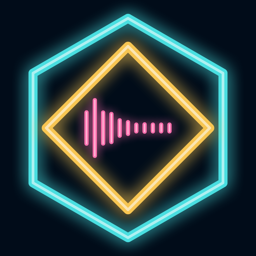

  
  
<h1>Music Shapes</h1>
Turn shapes into rhythms.

## Contact

Questions, problems or ideas? Email [{{ site.email }}](mailto:{{ site.email }}). It helps to say which iPhone or iPad you have and which version of Music Shapes, shown under ⓘ in the app.

## How it works

- Every shape goes round once per bar and plays its sound at each corner, clockwise from the top. A triangle plays three evenly spaced hits per bar and a square four, so shapes with different numbers of sides play rhythms against each other.
- **Rotate** moves a shape's hits off the beat.
- Tap a shape to change its sound, colour, sides, tuning and mix. Tap one of its corner dots to mute that hit or change its volume or pitch.
- The share button bounces your beat to a WAV file or a square video.

## Music Shapes Pro

Pro is a one-time purchase, not a subscription. It adds unlimited shapes, melodic and FX sounds, recording and importing your own sounds, EQ, compressor, delay and reverb, pitch for every corner, 8-bar bounces, and videos without the "Made with Music Shapes" mark.

**Restoring Pro** on a new device or after reinstalling: open any Pro feature, such as the EQ tab, and tap **Restore Purchases**. Use the same Apple Account you bought Pro with.

**Refunds** are handled by Apple at [reportaproblem.apple.com](https://reportaproblem.apple.com).

## Privacy

Music Shapes collects no data. Your shapes and sounds stay on your device. Read the [privacy policy](privacy/).
